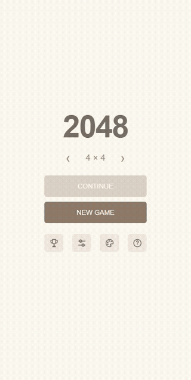

# 2048 Choice

2048 for long high-score runs, with a few things I kept wishing other versions had.

## Why I made this

I made this for myself and anyone else who likes trying for high scores in 2048.

When I'm building a board around 2s, I don't want to keep undoing a move just because a 4 spawned. Here, you choose whether the next tile is a 2 or a 4. Its position is still random.

The other problem is playing too fast. One accidental swipe can mess up a good board, and sometimes I've already swiped again before I notice. A single undo can't always get me back. Unlimited undo lets me go back through both moves, or further if I need to. Standard undo is there too, with separate high scores.

There are also optional warnings before moves that could disturb your large tiles or pull them away from their corner. They won't catch every mistake, but they give you a chance to stop and check the move.

I wanted to spend more time working on a run and less time fighting the controls. These are scores played with those conveniences, so I wouldn't compare them directly with a no-undo run in the original game.

## What it looks like

[](docs/media/gameplay.mp4)

[Watch or download the gameplay video](docs/media/gameplay.mp4). The preview shows actual play in this version, including the spawn switch and undo.

## What's in it

- Boards from 3×3 to 8×8, with a separate saved game for each size.
- A 2/4 switch for new tiles. Spawning a 4 directly skips the four points you'd earn by merging two 2s.
- Standard undo for the last move, or Unlimited undo to go back through the whole run. Your history survives closing the app.
- Optional assistance: large-tile warnings, corner warnings, and smart spawning on 4×4. Turn it on with the shield next to Home; hold the shield to read the rules.
- Four themes, local best scores, and a shared leaderboard. Standard and Unlimited have separate rankings; assistance uses the same rankings.
- Offline gameplay. Internet is only needed for the leaderboard. No ads.

## Play on Android

The app needs Android 8 or later and an up-to-date Android System WebView.

Build the APK using the steps below, copy `dist/2048-Choice.apk` to your phone, and open it to install. Android may ask you to allow installs from your file manager.

To update an existing installation, install an APK signed with the same key over it. Don't uninstall first: uninstalling or clearing app data removes your saves and guest leaderboard identity.

## Build it

The Android app is a small Java shell around a bundled HTML, CSS and JavaScript game. It doesn't load a hosted website.

The build scripts currently target Windows. You'll need Python 3.9+, JDK 17+, and Node.js for the tests. Python, Java and Node should be on your PATH.

```powershell
python scripts/setup_sdk.py
node --test tests/engine.test.mjs tests/completion.test.mjs tests/leaderboard.test.mjs
python scripts/build_apk.py
```

The setup script downloads Android Platform 35 and Build Tools 35.0.0 from Google and checks their hashes. The build creates `dist/2048-Choice.apk` and verifies its signature.

The first build creates a signing key in `.signing/`. Keep that folder private and back it up if you plan to distribute updates. It is excluded from Git, along with downloaded tools and build output.

Browser checks use Playwright and Chrome:

```powershell
npm install --no-save --package-lock=false playwright
node tests/ui-smoke.mjs
node tests/touch-undo.mjs
node tests/saved-games.mjs
node tests/interaction-help.mjs
node tests/completion-ui.mjs
```

Set `CHROME_PATH` if Chrome isn't installed at the usual Windows location. The browser tests mock Firebase and don't upload test scores.

## Leaderboard

The supplied build connects to a shared Firebase leaderboard. Pick a nickname in the trophy screen. Saves and undo history stay on your device; the leaderboard receives your nickname, best score, largest tile and the time of that record.

This is a casual leaderboard. Scores come from the app, so it isn't proof that a run was played honestly. See [SECURITY.md](SECURITY.md) for the checks and limitations, including the pending Firestore rules update.

If you're distributing your own version, use your own Firebase project: enable Anonymous Authentication, create a Firestore database, publish `firebase/firestore.rules`, and replace the public app configuration in `app/src/main/assets/firebase-config.js`. Never put an admin credential or service-account key in the app.

## Code

- `app/src/main/assets/` — game logic, screens, themes, saves and leaderboard client.
- `app/src/main/java/` — Android wrapper.
- `firebase/` — Firestore access rules.
- `tests/` — game, storage, interface and leaderboard checks.
- `scripts/` — Android setup and APK build.

The completion screen compares your score with the theoretical maximum for that board size: 16,352 for 3×3 and 3,932,100 for 4×4. The formula is documented in [OEIS A244056](https://oeis.org/A244056).
